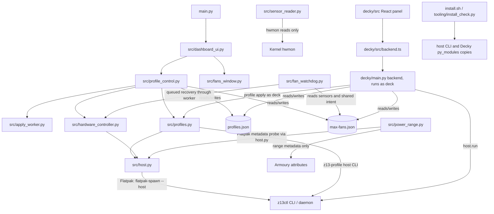
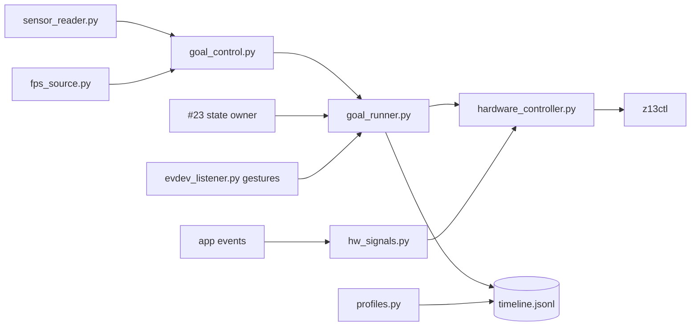

# Code map

This map describes the functional source tree on `main` at `e575835` (2026-11-02): the 0.5.1 release, the fan and power repair PRs (#89, #92, #93, #95, #97) and the Decky, installer and profile changes after them are merged. Open work is tracked in `PIPELINE.md` and the issues. Device verification remains separate from automated tests; the [release record](../docs/releases/0.5.1.md) records which Desktop checks have passed and which Game Mode, resume and cold-boot checks remain pending. The Decky flow has its own map in [`decky.md`](decky.md).

## System connections

The desktop Flatpak and Decky are two frontends to the same profile and Max Fans files under `~/.config/z13-helper/`. They read those files when needed; transient UI state such as a pending profile selection and watchdog counters remain in memory. The z13ctl daemon has its own persisted custom-profile state under `~/.local/state/z13ctl/`, separate from the app's profile store. The profile engine explicitly applies or resets z13ctl curves and clears stale custom TDP state when required; the two stores are not interchangeable.

`src/host.py` selects its execution mode once per process. Flatpak calls use `flatpak-spawn --host`; the host `z13-profile` CLI runs directly as the invoking user; Decky runs as the `deck` user with that session's runtime environment. `runuser -u deck` is used only for a root process that explicitly requests `as_deck=True`, not for every Decky command. The Decky plugin includes root-owned copies of shared Python helpers under `py_modules/`; the backend itself runs as `deck`.

## Desktop app and shared engine

| Module | Responsibility and connections |
|---|---|
| `main.py` | Process entry point, logging, single-instance guard and Qt application. |
| `src/dashboard_ui.py` | Main window, profile picker, Max Fans control (records goal transitions to `timeline.jsonl`), telemetry, `read_timeline` and tray behavior; opens Fans + Power. |
| `src/fans_window.py`, `src/fan_curve_widget.py` | TDP/PL1-PL3 and Curve Optimizer controls, fan curve editor, and range-aware power sliders. |
| `src/profile_control.py` | Shared profile model for both desktop windows; persists edits and dispatches live field updates through `ApplyWorker`. |
| `src/apply_worker.py` | Serial background queue for desktop hardware work, including profile applies and watchdog recovery. |
| `src/profiles.py` | Profile schema and JSON store, built-ins and migrations, `z13-profile` CLI, ordered profile apply (appends each apply with `before`/`after` and rollback snapshot to `timeline.py`, with no journal line since a profile apply is not a Principle 7 host change; recording failures never fail the apply), and lightbar recovery. Each profile may also carry per-device lighting intent (`LIGHTING_MODES`, `LIGHTING_COLORS`, `set_profile_lighting`), and enter/exit hooks are bounded by `HOOK_TIMEOUT_S` (120 s). Used by the app and installed host CLI; Decky invokes that same CLI for app-profile changes. |
| `src/max_fans_state.py` | Shared Max Fans intent and saved-curve snapshot in `max-fans.json`, with inter-process locking and atomic writes. |
| `src/fan_watchdog.py` | Shared Desktop/Game Mode recovery rules. In the desktop app, recoveries use the worker queue; stale dropped-curve recoveries are canceled if the queued profile operation has already changed Max Fans intent or restored a curve. |
| `src/sensor_reader.py` | Read-only hwmon temperatures, fan RPM, custom-curve mode and points. It does not write hardware. |
| `src/power_range.py` | Determines per-rail slider bounds from kernel min/max metadata and z13ctl's backend selection rules. It never reads a live PPT `current_value`. |
| `src/hardware_controller.py` | z13ctl command wrappers for profile, fan, power, battery, lighting and Curve Optimizer operations. Every write is bounded by `host.Z13CTL_WRITE_TIMEOUT_S` (20 s); a timeout is reported, not retried. |
| `src/host.py` | Shared command seam for Flatpak, host, and Decky contexts; owns `Z13CTL_WRITE_TIMEOUT_S`. |
| `src/config_manager.py`, `src/install_record.py`, `src/single_instance.py`, `src/theme.py` | App preferences, install metadata/logging choice, one-process coordination and styling (including the performance-mode tile icons). |
| `src/app_log.py`, `src/log_dialog.py` | Rotating app log, crash and fatal reports and the fan-trace files under `~/.local/state/z13-helper/`; the Help -> Error log window that shows them. The Decky backend writes its fan trace through the same `FanTrace`. |
| `src/timeline.py` | Append-only `~/.local/state/z13-helper/timeline.jsonl` store of hardware and host changes with `before`/`after` snapshots, Phase 12c rollback records, size-capped rotation and partial-line skipping; emits Principle 7 journal lines from the same call for host changes (profile applies and goal changes record with `journal=False`). Callers treat recording as best-effort and catch any `Exception`. Decky's timeline path follows its hardcoded `FAN_TRACE_DIR` (user `deck` only). Read and written by the desktop app, `z13-profile`, `install.sh` / `installers.py`, `post_update/runner.py`, `post_update_state.py` and Decky (`py_modules/timeline.py`). |
| `src/crash_report.py`, `src/crash_scrub.py`, `src/crash_queue.py` | Shared automatic crash reporting: startup hooks, scrubbed ZIPs, bounded offline queue and daily upload limit. Build configuration and the default-on Error log toggle are described in [`docs/crash-reporting.md`](../docs/crash-reporting.md); live delivery verification remains pending (#82). |
| `src/versions.py` | Shared version floor (`DECKY_MIN`, 3.3.0) and `older_than`; used by `installers.py` and `update_watch.py`. |
| `src/update_watch.py`, `src/updates_dialog.py`, `src/installers.py`, `src/post_update_state.py` | Upstream checks, SteamOS `BUILD_ID` transition detection, updates/repair UI (bundles `host`, `versions`, and `timeline` for stdin host runs) and installation actions (records `install` entries to `timeline.jsonl`). |
| `src/screen_brightness.py`, `src/evdev_listener.py` | Built-in display brightness and the Desktop Mode side-button reader. |

### Profile apply and Max Fans ordering

Profile state has two related but distinct pieces: `profiles.json` describes each profile's requested curve, while `max-fans.json` records the current Max Fans toggle and the curve to restore when it is turned off. When an apply begins with Max Fans enabled, it temporarily publishes the shared flag as off so the watchdog cannot pin the old 100% curve over the transition. It then writes the base platform profile, applies power settings, and writes the selected curve (or the 100% curve). For a Max Fans target, the flag becomes on only after the 100% curve command succeeds. If the base profile changed but power cleanup or curve application fails, the flag remains off; if the base command itself fails, the prior enabled intent is preserved. The shared recovery code also rechecks intent before reapplying a dropped curve and before the final 100% write.

The built-in Balanced and Turbo curve migration only changes a profile when name, built-in marker, base profile and full old curve all match. An edited or custom profile is preserved. If Max Fans is enabled and its saved raw-PWM snapshot exactly matches the active built-in's old curve, the matching snapshot is migrated too; unrelated, absent, disabled or `null` snapshots remain as they were. Curve points from 40 °C upward preserve the old interpolation; a duplicate low-temperature anchor defines the first plateau below 40 °C. This is a mitigation for the observed low-temperature behavior, not a proven firmware root cause.

## Power-range selection and safety

`power_range.detect_ranges()` mirrors z13ctl 1.4.2 backend selection: Armoury is selected when PL1's `current_value` node exists, is writable from the host, and has sane positive min/max metadata. It reads only `min_value` and `max_value` for each available rail (`ppt_pl1_spl`, `ppt_pl2_sppt`, `ppt_pl3_fppt`); it never reads the value stored in `current_value`. If called inside Flatpak, a stdlib-only probe runs through `host.run()` on the host because sandbox permission checks on sysfs can falsely report that Armoury is not writable. Per-rail missing or malformed metadata uses the broad 5–93 W UI fallback because the slider API requires a bound for every rail. The legacy `asus-nb-wmi` path uses that same 5–93 W bound.

The desktop Fans + Power window and Decky `power_state()` display stored profile overrides clamped for the selected kernel range without rewriting the saved profile. A profile value outside that range produces a note; moving a slider saves the shown values. With no profile override, frontends show an explicit unset/default state rather than implying that fallback slider numbers are active hardware limits. z13ctl remains the hardware writer. Avoid polling Armoury `current_value` for telemetry or UI display: the EC access can hang on affected resume paths.

## Decky/Game Mode

`decky/main.py` exposes callable methods to the QAM panel and imports shared `fan_watchdog.py`, `sensor_reader.py`, `host.py`, `power_range.py` and `timeline.py` from the plugin's installed `py_modules/` copies. It serializes its writes with an asyncio lock and runs blocking host work in threads. In Game Mode it runs the shared fan watchdog; in Desktop Mode it stands down while the resident PyQt app owns that watchdog. App-profile selection invokes the installed `z13-profile` CLI, which is the same engine used by the desktop app. Direct performance-profile, TDP, charge-limit, brightness and telemetry calls remain separate Decky API methods. See [`decky.md`](decky.md) for the flow and persisted state details.

## Planned (after 1.0)

Modules planned by Phases 15 and 16 (`docs/ROADMAP.md` §10a, §10b). Each moves from planned to present in the PR that builds it. None writes hardware except through `z13ctl` (via `hardware_controller.py`).

| Module | Status | Responsibility and connections | Issue |
|---|---|---|---|
| `src/goal_control.py` | planned | Pure goal decision: goal + hwmon/fps readings + current setpoints → next TDP and curve, bounded by `power_range.py`. No I/O. | #123 |
| `src/profiles.py` (`goal` field) | planned | Optional per-profile goal; `max_fans` migrates to goal `max`. | #124 |
| `src/goal_runner.py` | planned | The one curve/TDP writer while a goal is active; reads `sensor_reader.py` and `fps_source.py`, writes through `apply_worker.py` (desktop) or `decky/main.py` (Game Mode), coordinated by the #23 state owner; takes over `fan_watchdog.py`'s curve-drop recovery. | #125 |
| `src/fps_source.py` | planned | Read-only frame-rate reading in Game Mode (source chosen by the probe). | #126 |
| `src/hw_signals.py` | present (mapping #129, runner #130) | Pure event → lightbar pattern mapping: signals (profile change, throttling, charge limit, goal not met, update attention) with priority, one-shot expiry, a 2 s write rate limit, restore of the owner's lighting and an off switch. The mapping has no I/O or clock; `SignalRunner` (#130) plays it through `hardware_controller.set_lighting` (with its lightbar recovery) on `ApplyWorker`, fed by `ProfileControl.profile_applied`, and the `signals_enabled` config switch ("Light signals" checkbox) turns it off. | #129, #130 |
| `src/evdev_listener.py` (gestures) | present (#131) | `GestureDetector`: a triple press (0.35 s chain; presses 1-2 keep their actions, hold is impossible, see `docs/BUTTON-AND-INPUTPLUMBER.md`) cycles profiles via `CYCLE` in `--emit`, the app's `cycle_profile()` and the `cycle` socket command (Game Mode watcher); `--probe` prints press/release events. Goals follow Phase 15. | #131 |
| shared touch UI | planned | Desktop window and QAM from one set of parts; shape decided in `docs/adr/0002-shared-touch-ui.md`. | #132, #133 |
| `src/timeline_view.py`, `src/timeline_dialog.py` | present (#135) | Timeline view beside `updates_dialog.py` (File > Timeline, footer button): entries newest first, compare two entries' `after` states, roll back an entry whose rollback record is a `profile` one (runs `profiles.apply_by_name(record=False)`, then appends its own `rollback_of` entry); entries that can't be undone show why; a SteamOS update is one row listing its changes. `goal` and `backup_restore` records show "not built into the app yet". The QAM shows a short list from `get_timeline` (`decky/src/components/Timeline.tsx`). | #135 |

## Host installation, tests and references

| Path | Responsibility |
|---|---|
| `install.sh`, `tooling/install_check.py` | Manifest-driven host install/repair and verification; `record()` writes `install.json` and appends `install` (and `steamos_update` when `BUILD_ID` changed) entries to `timeline.jsonl` with Phase 12c backup rollback maps. Copies `src/profiles.py` as `z13-profile`, `src/host.py` and `src/timeline.py` beside it, and shared helpers into Decky's `py_modules/`. |
| `packaging/host/` | Reference systemd, polkit and udev files; the z13ctl setup owns its permissions unit and udev rule. The fan-resume and lightbar-reset units each run a small `.sh` beside them. `gamescope/displays/asus.rogflowz13.lcd.lua` is the Gamescope display script for the panel's 48-180 Hz VRR range, installed by `tooling/install_check.py`'s manifest (device acceptance pending). |
| `tooling/profiles/`, `tooling/boondock` | Compatibility wrappers and Boondock's hardware/session commands. Built-in profile hooks use its session-only commands. |
| `tooling/diag/`, `tooling/z13_gamemode_report.py`, `tooling/z13_fanlog.sh` | Read-only or explicitly invoked diagnostics, Game Mode reporting and the fan/thermal logger. |
| `tooling/z13_cdp.py`, `tooling/z13_qam.py`, `tooling/spike1_qam_test.py` | Dependency-free CDP bridge to Steam's Game Mode UI (opens the side menus without input emulation) used by `z13-button-watcher`; `z13_qam.py` is its back-compat alias and `spike1_qam_test.py` is the by-hand Game Mode check. |
| `tooling/rss_watch.py`, `tooling/screenshots.py` | Bounded RSS sampler for one identified process (used on the Decky backend); renders the README screenshots offscreen from the real app code inside the Flatpak. |
| `tooling/post_update/recipe.py`, `tooling/post_update/runner.py` | Post-update recipe format (ordering, keyring insertion, plan text) and runner (`check_all`, `run_plan`, `make_timeline_recorder` for `timeline.jsonl` + Principle 7 journal lines; wiring into a production `Env` awaits the Env builder, #109/#110). |
| `tooling/post_update/builtin.py` | Built-in recipes 1-3 (amdgpu args in `grub-steamos` + `update-grub`, pacman keyring, carry-forward list health). Reads and runs only through the injected `HostIO`; checks are `na` off SteamOS on a GZ302 and applies refuse there. |
| `tooling/post_update/builtin_4_6.py` | Built-in recipes 4 and 6 (SteamOS `/etc` snapshot copied to `~/.local/share/z13-helper/etc-backups`, ROCm pack). Host access only through the injected `Sys`. |
| `tooling/post_update/local.py` | Local recipe loader: `parse_local` turns one TOML recipe into a plain dict (checked fields, ids and flags); `load_dir` reads every `*.toml` in a folder, in file-name order, and returns `(recipes, errors)` so a bad or duplicate file is an error row and the rest still load. Pure reading; it never runs a recipe's `check` or `apply`. |
| `tests/`, `decky/tests/` | Pytest logic tests, Decky `unittest` tests, and the separate Node test for `profileSwitch.ts`. `tests/conftest.py` blocks subprocess and network calls and `tests/fake_host.py` fakes `host.run`; the per-module test files are listed in `tests/README.md`. |
| `.github/workflows/tests.yml` | CI on every push and PR: pytest and the Decky unittest suite on Linux; it does not run the Node test. |
| `decky/rollup.config.js`, `decky/src/` | Decky bundle build; `index.tsx`, `hooks.ts` and `components/` (`PowerLimits`, `BatteryLimit`, `KeyboardBrightness`, `Telemetry`) are the QAM panel, mapped in [`decky.md`](decky.md). |
| `flatpak/` | Flatpak manifest (`io.github.iannitram.Z13Helper.yml`), `build.sh`, the in-sandbox `launch.sh`, desktop file and AppStream metadata. |

`z13ctl` is the sole hardware command backend. Decky Loader provides the Game Mode QAM surface; G-Helper informs the desktop layout and interaction model. The device verification checklist is in [`docs/ROADMAP.md`](../docs/ROADMAP.md); automated tests do not replace pending on-device checks.

Decky's file watcher must be stopped before changing installed plugin files: otherwise every
individual copy can trigger a reload against a partial bundle (#100). `install.sh` quiesces the loader, stages and byte-verifies the files, then restarts it (`quiesce_loader`, `start_loader`, `resume_loader`). It leaves an
unchanged plugin running and starts the loader after changed files are installed. It also enforces the Decky Loader minimum from `src/versions.py`. Its backend
startup log alone is not frontend evidence. After a changed-plugin install/repair (#122),
`decky_frontend_check` runs `tooling/z13_cdp.py --decky-frontend-check --since <repair timestamp>`:
the loader's `/plugins/Z13-Helper/dist/index.js` must serve HTTP 200 JavaScript (the ES-module
route is auth-exempt), and Steam's `SharedJSContext` must have the real plugin registered in
`window.DeckyPluginLoader.plugins`, with no pending reload or new buffered CEF dynamic-import
errors since before quiescence. Entry/registration errors fail the installer separately from
backend startup; absent Steam UI/debug access reports **not checked** with a reason. The probe
does not import or reload the plugin. An unchanged repair skips it; a dry run reports not checked.
The route and registry assumptions follow Decky's upstream
[`loader.py`](https://github.com/SteamDeckHomebrew/decky-loader/blob/main/backend/decky_loader/loader.py)
and [`plugin-loader.tsx`](https://github.com/SteamDeckHomebrew/decky-loader/blob/main/frontend/src/plugin-loader.tsx).
The route, registry/export shape and buffered error replay still need confirmation on the device,
including one changed-plugin repair passing with Steam's gamepad UI running.
