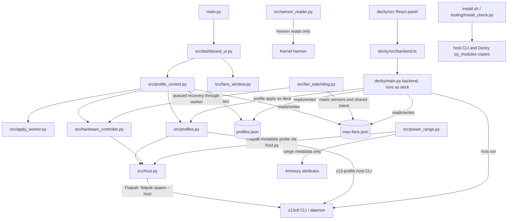

# Code map

This map describes the functional source tree at `8c857cd` (2026-10-30), with the 0.5.1 release metadata and documentation revision. It is a map of this checkout, not a claim that every change has merged. Current review status: PRs #89, #92, #93, #95 and #97 are open; #97 is stacked on #93. Device verification remains separate from automated tests; the [release record](../docs/releases/0.5.1.md) records which Desktop checks have passed and which Game Mode, resume and cold-boot checks remain pending. The Decky flow has its own map in [`decky.md`](decky.md).

## System connections

The desktop Flatpak and Decky are two frontends to the same profile and Max Fans files under `~/.config/z13-helper/`. They read those files when needed; transient UI state such as a pending profile selection and watchdog counters remain in memory. The z13ctl daemon has its own persisted custom-profile state under `~/.local/state/z13ctl/`, separate from the app's profile store. The profile engine explicitly applies or resets z13ctl curves and clears stale custom TDP state when required; the two stores are not interchangeable.

`src/host.py` selects its execution mode once per process. Flatpak calls use `flatpak-spawn --host`; the host `z13-profile` CLI runs directly as the invoking user; Decky runs as the `deck` user with that session's runtime environment. `runuser -u deck` is used only for a root process that explicitly requests `as_deck=True`, not for every Decky command. The Decky plugin includes root-owned copies of shared Python helpers under `py_modules/`; the backend itself runs as `deck`.

## Desktop app and shared engine

| Module | Responsibility and connections |
|---|---|
| `main.py` | Process entry point, logging, single-instance guard and Qt application. |
| `src/dashboard_ui.py` | Main window, profile picker, Max Fans control, telemetry and tray behavior; opens Fans + Power. |
| `src/fans_window.py`, `src/fan_curve_widget.py` | TDP/PL1-PL3 and Curve Optimizer controls, fan curve editor, and range-aware power sliders. |
| `src/profile_control.py` | Shared profile model for both desktop windows; persists edits and dispatches live field updates through `ApplyWorker`. |
| `src/apply_worker.py` | Serial background queue for desktop hardware work, including profile applies and watchdog recovery. |
| `src/profiles.py` | Profile schema and JSON store, built-ins and migrations, `z13-profile` CLI, ordered profile apply, and lightbar recovery. Used by the app and installed host CLI; Decky invokes that same CLI for app-profile changes. |
| `src/max_fans_state.py` | Shared Max Fans intent and saved-curve snapshot in `max-fans.json`, with inter-process locking and atomic writes. |
| `src/fan_watchdog.py` | Shared Desktop/Game Mode recovery rules. In the desktop app, recoveries use the worker queue; stale dropped-curve recoveries are canceled if the queued profile operation has already changed Max Fans intent or restored a curve. |
| `src/sensor_reader.py` | Read-only hwmon temperatures, fan RPM, custom-curve mode and points. It does not write hardware. |
| `src/power_range.py` | Determines per-rail slider bounds from kernel min/max metadata and z13ctl's backend selection rules. It never reads a live PPT `current_value`. |
| `src/hardware_controller.py` | z13ctl command wrappers for profile, fan, power, battery, lighting and Curve Optimizer operations. |
| `src/host.py` | Shared command seam for Flatpak, host, and Decky contexts. |
| `src/config_manager.py`, `src/install_record.py`, `src/single_instance.py`, `src/theme.py` | App preferences, install metadata/logging choice, one-process coordination and styling. |
| `src/update_watch.py`, `src/updates_dialog.py`, `src/installers.py` | Upstream checks, updates/repair UI and installation actions. |
| `src/screen_brightness.py`, `src/evdev_listener.py` | Built-in display brightness and the Desktop Mode side-button reader. |

### Profile apply and Max Fans ordering

Profile state has two related but distinct pieces: `profiles.json` describes each profile's requested curve, while `max-fans.json` records the current Max Fans toggle and the curve to restore when it is turned off. When an apply begins with Max Fans enabled, it temporarily publishes the shared flag as off so the watchdog cannot pin the old 100% curve over the transition. It then writes the base platform profile, applies power settings, and writes the selected curve (or the 100% curve). For a Max Fans target, the flag becomes on only after the 100% curve command succeeds. If the base profile changed but power cleanup or curve application fails, the flag remains off; if the base command itself fails, the prior enabled intent is preserved. The shared recovery code also rechecks intent before reapplying a dropped curve and before the final 100% write.

The built-in Balanced and Turbo curve migration only changes a profile when name, built-in marker, base profile and full old curve all match. An edited or custom profile is preserved. If Max Fans is enabled and its saved raw-PWM snapshot exactly matches the active built-in's old curve, the matching snapshot is migrated too; unrelated, absent, disabled or `null` snapshots remain as they were. Curve points from 40 °C upward preserve the old interpolation; a duplicate low-temperature anchor defines the first plateau below 40 °C. This is a mitigation for the observed low-temperature behavior, not a proven firmware root cause.

## Power-range selection and safety

`power_range.detect_ranges()` mirrors z13ctl 1.4.2 backend selection: Armoury is selected when PL1's `current_value` node exists, is writable from the host, and has sane positive min/max metadata. It reads only `min_value` and `max_value` for each available rail (`ppt_pl1_spl`, `ppt_pl2_sppt`, `ppt_pl3_fppt`); it never reads the value stored in `current_value`. If called inside Flatpak, a stdlib-only probe runs through `host.run()` on the host because sandbox permission checks on sysfs can falsely report that Armoury is not writable. Per-rail missing or malformed metadata uses the broad 5–93 W UI fallback because the slider API requires a bound for every rail. The legacy `asus-nb-wmi` path uses that same 5–93 W bound.

The desktop Fans + Power window and Decky `power_state()` display stored profile overrides clamped for the selected kernel range without rewriting the saved profile. A profile value outside that range produces a note; moving a slider saves the shown values. With no profile override, frontends show an explicit unset/default state rather than implying that fallback slider numbers are active hardware limits. z13ctl remains the hardware writer. Avoid polling Armoury `current_value` for telemetry or UI display: the EC access can hang on affected resume paths.

## Decky/Game Mode

`decky/main.py` exposes callable methods to the QAM panel and imports shared `fan_watchdog.py`, `sensor_reader.py`, `host.py` and `power_range.py` from the plugin's installed `py_modules/` copies. It serializes its writes with an asyncio lock and runs blocking host work in threads. In Game Mode it runs the shared fan watchdog; in Desktop Mode it stands down while the resident PyQt app owns that watchdog. App-profile selection invokes the installed `z13-profile` CLI, which is the same engine used by the desktop app. Direct performance-profile, TDP, charge-limit, brightness and telemetry calls remain separate Decky API methods. See [`decky.md`](decky.md) for the flow and persisted state details.

## Host installation, tests and references

| Path | Responsibility |
|---|---|
| `install.sh`, `tooling/install_check.py` | Manifest-driven host install/repair and verification. The install copies `src/profiles.py` as `z13-profile`, `src/host.py` beside it, and shared helpers into Decky's `py_modules/`. |
| `packaging/host/` | Reference systemd, polkit and udev files; the z13ctl setup owns its permissions unit and udev rule. |
| `tooling/profiles/`, `tooling/boondock` | Compatibility wrappers and Boondock's hardware/session commands. Built-in profile hooks use its session-only commands. |
| `tooling/diag/`, `tooling/z13_*.py` | Read-only or explicitly invoked diagnostics and Game Mode reporting. |
| `tests/`, `decky/tests/` | Pytest logic tests, Decky `unittest` tests, and the separate Node test for `profileSwitch.ts`. CI runs pytest and Decky unittest; it does not run the Node test. |
| `flatpak/` | Flatpak manifest, runtime setup and build script. |

`z13ctl` is the sole hardware command backend. Decky Loader provides the Game Mode QAM surface; G-Helper informs the desktop layout and interaction model. The device verification checklist is in [`docs/ROADMAP.md`](../docs/ROADMAP.md); automated tests do not replace pending on-device checks.

Decky's file watcher must be stopped before changing installed plugin files: otherwise every
individual copy can trigger a reload against a partial bundle (#100). The installer leaves an
unchanged plugin running and starts the loader after changed files are installed. Its backend
startup check must be supplemented by a Steam frontend check when investigating import errors.
