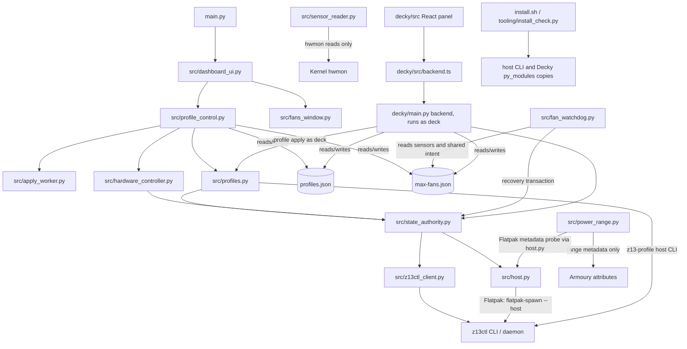
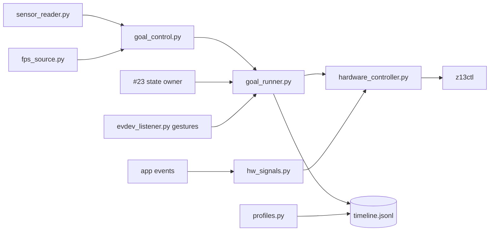

# Code map

Refreshed 2026-11-04 from origin/main 8521ffc. Open PRs are not yet reflected: #153 (state owner), #154 (post-update repair) and the `build/*` branches. The rest of this note was written for `e575835` (2026-11-02) and still holds: the 0.5.1 release, the fan and power repair PRs (#89, #92, #93, #95, #97) and the Decky, installer and profile changes after them are merged. Open work is tracked in `PIPELINE.md` and the issues. Device verification remains separate from automated tests; the [release record](../docs/releases/0.5.1.md) records which Desktop checks have passed and which Game Mode, resume and cold-boot checks remain pending. The Decky flow has its own map in [`decky.md`](decky.md). The latest code audit is [`docs/audit/2026-11-04-code-audit.md`](../docs/audit/2026-11-04-code-audit.md).

## System connections

The desktop app, tray, host profile CLI, Decky plugin and fan recovery all route writes
through `src/state_authority.py`. It holds a shared hardware transaction lock across
profile applies/recoveries and validates queued field edits against fresh backend
selection. `z13ctl` owns named performance settings; `profiles.json` mirrors that state
and retains app-only hooks, base, lighting and EPP intent. `max-fans.json` retains the
restore snapshot and confirmed intent. No second app daemon is introduced.

A host `z13-profile watch` subscribes before its first snapshot and resnapshots after
reconnect, reconciling backend selection/settings without a hardware write. The shared
`state_stream.py` reader delivers those records to the desktop Qt signal and Decky
`profile_state` event. Both frontends refresh from those events; the desktop profile
poll has been removed. Telemetry, fan safety checks and screen brightness keep their
independent sampling. Older daemons retain the bounded legacy command path; they
cannot provide named-profile identity or field targeting.

`src/host.py` selects its execution mode once per process. Flatpak calls use `flatpak-spawn --host`; the host `z13-profile` CLI runs directly as the invoking user; Decky runs as the `deck` user with that session's runtime environment. `runuser -u deck` is used only for a root process that explicitly requests `as_deck=True`, not for every Decky command. The Decky plugin includes root-owned copies of shared Python helpers under `py_modules/`; the backend itself runs as `deck`.

## Desktop app and shared engine

| Module | Responsibility and connections |
|---|---|
| `main.py` | Process entry point. Key function: `main()`. Sets up `app_log`, `crash_report` and `install_record`, takes the single-instance lock before importing PyQt6, then builds `HardwareController`, `SensorReader`, `ConfigManager` and `DashboardUI`. Called by `launch.sh`, the user unit and the desktop file. |
| `src/dashboard_ui.py` | Main window, profile picker, Max Fans control (records goal transitions to `timeline.jsonl`), lighting, battery, brightness changes (record `timeline.jsonl` setting entries), telemetry, `read_timeline` and tray behavior; opens Fans + Power and the side-button reader (host evdev reader, legacy InputPlumber fallback). Key class: `DashboardUI`; constants `APP_VERSION`, `_CONFIG_PATH`. Called by `main.py` and `tooling/screenshots.py`. Performance panel includes CPU Boost (amd-pstate EPP) with live readout. |
| `src/fans_window.py` | Fans + Power window: TDP/PL1-PL3 sliders with range-aware bounds, Curve Optimizer and the fan curve editor host. Key classes: `FansWindow`, `_SliderRow`. Uses `power_range.py`, `profile_control.py`, `profiles.py`. Called by `DashboardUI`. |
| `src/fan_curve_widget.py` | Interactive 8-point fan curve editor. Key: `FanCurveWidget`, `floor_pct`. Called by `FansWindow`. |
| `src/profile_control.py` | Desktop adapter: profile editor, worker submissions, and Qt event dispatch for both windows and tray; delegates hardware edits to the shared authority. Key class: `ProfileControl` (`switch`, `save`, `reapply_active`, `factory_defaults`). Called by `DashboardUI` and `FansWindow`. |
| `src/state_authority.py` | Shared transaction/write owner: named API probe, explicit thermal targets, field edits, Max Fans, platform-profile switch, lighting, sysfs screen-backlight write (`set_screen_backlight`) and named fan recovery. Edits to an inactive profile are stored and mirrored without a live push; `apply_profile` runs the GUI switch/re-apply as one transaction. Never retries failed socket writes through the CLI. |
| `src/z13_helper_cli.py` | Host `z13-helper` CLI: argparse dispatch for status, profiles, TDP, fan curve/Max Fans, battery, brightness (keyboard and screen), lighting, Boondock, button status, post-update recipes and crash queue. Reads through the shared modules and sends every write through `state_authority.py`; `--json` is available on every command. Installed by `tooling/install_check.py`'s manifest; `z13-profile` remains the profile engine CLI. Called by a terminal. |
| `src/mcp_server.py` | Local stdio Model Context Protocol server for `z13-helper mcp`: JSON-RPC initialize/tools/list/tools/call on stdin/stdout, with one tool per CLI leaf command. Each call rebuilds the same CLI argv, so reads use the shared modules and writes keep the CLI's clamps and `state_authority` ownership. Installed with the CLI by `tooling/install_check.py`; `install.sh` registers it with `claude mcp add z13-helper -- z13-helper mcp`. Called by a local MCP client. |
| `src/z13ctl_client.py` | Stdlib newline-JSON socket client, Flatpak/root host bridge, named-profile mirroring and cancellable subscription/reconnect loop. |
| `src/apply_worker.py` | Serial background queue for desktop hardware work, including profile applies and watchdog recovery. Key class: `ApplyWorker` (`submit`, signal `done`). Called by `DashboardUI` and `ProfileControl`. |
| `src/profiles.py` | Key API: `load_store`, `upsert_profile`, `apply`, `apply_by_name`, `validate`, `apply_tdp`, `apply_epp`, `recover_lightbar`, `main` (the CLI). Profile schema and JSON store, built-ins and migrations, `z13-profile` CLI, ordered profile apply (appends each apply with `before`/`after` and rollback snapshot to `timeline.py`, with no journal line since a profile apply is not a Principle 7 host change; recording failures never fail the apply), and lightbar recovery. EPP writes use `host.run` to write every cpufreq policy node under the ADR 0002 tmpfiles grant. The legacy TDP cleanup before a curve write runs only after the socket JSON profile-list probe succeeds, never on CLI listing headers. Each profile may also carry per-device lighting intent (`LIGHTING_MODES`, `LIGHTING_COLORS`, `set_profile_lighting`), and enter/exit hooks are bounded by `HOOK_TIMEOUT_S` (120 s). Used by the app and installed host CLI; Decky invokes that same CLI for app-profile changes. |
| `src/max_fans_state.py` | Shared Max Fans intent and saved-curve snapshot in `max-fans.json`, with inter-process locking and atomic writes. Key: `load`, `is_enabled`, `save`, `restore_plan`, `record_profile_curve`, `file_lock`, `migrate_legacy`. Called by `DashboardUI`, `ProfileControl` and `tooling/install_check.py`; `profiles.py` and `decky/main.py` carry their own copies of the same file handling. |
| `src/fan_watchdog.py` | Shared Desktop/Game Mode recovery rules; `FanTrace` keeps at most 256 entries and 120 s of history. In the desktop app, recoveries use the worker queue; stale dropped-curve recoveries are canceled if the queued profile operation has already changed Max Fans intent or restored a curve. Key: `FanWatchdog` (`tick`, `finished`), `FanWatchdogRunner`, `FanTrace`, `FAN_RECOVERY_LABEL`. Called by `DashboardUI`, `ProfileControl` and `decky/main.py` (installed copy). |
| `src/sensor_reader.py` | Read-only hwmon temperatures, fan RPM, custom-curve mode and points. CPU temperature comes from k10temp Tdie/Tctl (ACPI fallback, labeled as such); the GPU is the integrated amdgpu node matched by the Strix Halo PCI ID (`1002:1586`); an unreadable value is `None`, shown as unavailable. It does not write hardware. Key class: `SensorReader` (`get_fan_speeds`, `get_apu_temp`, `custom_fan_curve_enabled`, `custom_fan_curve_points`, `expected_fan_pwm`, `get_battery`). Called by `DashboardUI`, `main.py`, `decky/main.py` (installed copy) and `tooling/install_check.py`. |
| `src/telemetry_history.py`, `src/history_chart.py` | In-memory ring buffer of CPU/GPU temperature and both fan RPMs (last hour, one sample per tick at least 1.5 s apart, gaps kept as `None`, nothing written to disk) and the QPainter line chart the Fans + Power window draws from it. `dashboard_ui.py` feeds it from the telemetry tick. |
| `src/power_range.py` | Determines per-rail slider bounds from kernel min/max metadata and z13ctl's backend selection rules. It never reads a live PPT `current_value`. Key: `detect_ranges`, `tdp_status`, `bounds`, `RAILS`. Called by `FansWindow` and `decky/main.py` (installed copy). |
| `src/hardware_controller.py` | z13ctl command wrappers for profile, fan, power, battery, lighting, CPU Boost and Curve Optimizer operations. Every write is bounded by `host.Z13CTL_WRITE_TIMEOUT_S` (20 s); a timeout is reported, not retried. Key class: `HardwareController` (`set_profile`, `set_tdp`, `set_fancurve`, `set_fans_max`, `set_battery_limit`, `set_brightness`, `set_epp`). Called by `main.py`, `DashboardUI`, `ProfileControl` and `tooling/screenshots.py`. |
| `src/epp.py` | Pure CPU Boost (amd-pstate EPP) helpers: `parse_epp`, `parse_available`, `summarize_epp`, `epp_paths`, `EPP_CHOICES`. Called by `HardwareController`; `profiles.py` keeps its own EPP list because `z13-profile` runs without `src/epp.py`. |
| `src/host.py` | Shared command seam for Flatpak, host, and Decky contexts; owns `Z13CTL_WRITE_TIMEOUT_S`. `run` keeps at most `MAX_OUTPUT_BYTES` (1 MiB) of each of stdout and stderr (stdout first) (#30). Key: `run` (returns `Result(rc, out, timed_out)`, never raises), `command`, `detect`, `in_flatpak`, `deck_env`. Called by `profiles.py`, `hardware_controller.py`, `power_range.py`, `screen_brightness.py`, `installers.py`, `update_watch.py`, `updates_dialog.py`, `dashboard_ui.py`, `decky/main.py` (installed copy) and `tooling/z13_gamemode_report.py`. |
| `src/config_manager.py` | App preferences in `config.json`. Key class: `ConfigManager` (`get`, `set`, `load_config`, `save_config`). Called by `main.py`, `DashboardUI` and `tooling/screenshots.py`. |
| `src/install_record.py` | Install metadata and the logging choice in `install.json`. Key: `load`, `logging_enabled`, `set_logging`, `repair_argv`, `plan_text`, `verdict`, `failure_text`. Called by `main.py`, `DashboardUI` and `UpdatesDialog`; `decky/main.py` mirrors the logging check. |
| `src/single_instance.py` | One-process coordination: flock plus a Unix socket in `$XDG_RUNTIME_DIR/app/$FLATPAK_ID`. Key: `acquire_lock`, `send_command`, `InstanceServer`, `mark_user_quit`. Called by `main.py` and `DashboardUI`. |
| `src/theme.py` | Styling and shared widgets (including the performance-mode tile icons). Key: `ModeTile`, `Panel`, `pill`, `tip`. Called by `DashboardUI`, `FansWindow` and `UpdatesDialog`. |
| `src/app_log.py` | Rotating app log, crash and fatal reports and the fan-trace files under `~/.local/state/z13-helper/`. Key: `setup`, `set_to_disk`, `log_path`, `fan_trace_path`, `write_crash_report`, `RingHandler`, `shutdown`. Called by `main.py`, `DashboardUI`, `LogDialog` and `tooling/install_check.py`. The Decky backend writes its fan trace through `FanTrace` in `fan_watchdog.py`. |
| `src/log_dialog.py` | The Help -> Error log window (Ctrl+L) that shows the in-memory ring, logs and crash reports. Key class: `LogDialog`. Uses `app_log` and `crash_report`; called by `DashboardUI`. |
| `src/crash_report.py` | Shared automatic crash reporting: startup hooks, scrubbed ZIPs, upload to the build-time drop and the default-on Error log toggle. Key: `install`, `CrashReporter`, `reporting_enabled`, `set_reporting`, `upload_report`, `build_report`. Described in [`docs/crash-reporting.md`](../docs/crash-reporting.md); live delivery verification remains pending (#82). Called by `main.py`, `LogDialog` and `decky/main.py` (installed copy). |
| `src/crash_scrub.py` | Removes home path, host name and login name from report text. Key: `scrub`. Called by `crash_report.py`. |
| `src/crash_queue.py` | Bounded offline queue and daily upload limit for crash reports. Key class: `CrashQueue`. Called by `crash_report.py`. |
| `src/crash_build_defaults.json` | Empty placeholder build configuration (`{}`, so automatic crash reporting is unavailable). `install.sh` and `tooling/install_check.py` install it as the Decky plugin's `py_modules/_crash_build.json` when no real `src/_crash_build.json` exists; `tooling/build_crash_config.py` writes the real one. |
| `src/timeline.py` | Append-only `~/.local/state/z13-helper/timeline.jsonl` store of hardware and host changes with `before`/`after` snapshots, Phase 12c rollback records, size-capped rotation and partial-line skipping; emits Principle 7 journal lines from the same call for host changes (profile applies and goal changes record with `journal=False`). `record_setting_change` records manual hardware setting writes (the kinds `tdp`, `battery_limit` and `brightness`, `SETTING_KINDS`) also with `journal=False`, and records a failed write as unchanged (`before == after`, `ok: false`); `max_fans_goal_states` builds the before/after states for Max Fans goal entries, where a failed toggle likewise records `before == after`. Callers treat recording as best-effort and catch any `Exception`. Callers inside a hardware transaction (`state_authority`, `profiles.apply`, the app's Max Fans toggle, Decky's writes) pass `defer=True`: `enqueue` hands a deep copy to one background writer thread (bounded queue, `flush` at exit) so no timeline lock wait, write or `fsync` happens inside the hardware lock; a failed background write is logged with its error class only. The timeline folder is opened once with no-follow (`_open_dir_chain`), and the lock, append and rotation run relative to that descriptor. Decky's timeline path follows its hardcoded `FAN_TRACE_DIR` (user `deck` only). Read and written by the desktop app, `z13-profile`, `install.sh` / `installers.py`, `post_update/runner.py` (`Env.timeline`) and Decky (`py_modules/timeline.py`). |
| `src/versions.py` | Shared `APP_VERSION`, version floor (`DECKY_MIN`, 3.3.0) and `older_than`. Called by `installers.py`, `update_watch.py` and `tooling/install_check.py`. |
| `src/update_watch.py` | Upstream checks (z13ctl, G-Helper, kernel, SteamOS, this release) with an ETag cache. Key: `check`, `summary`, `new_items`, `mark_seen`, `is_newer`. Called by `DashboardUI` and `UpdatesDialog`. |
| `src/updates_dialog.py` | Updates and Repair install window (bundles `host`, `versions` and `timeline` for stdin host runs); feeds `installers.py` and `install.sh --repair` to a host Python through stdin and streams the log. Key: `UpdatesDialog`, `InstallDialog`, `InstallThread`, `UpdateCheckThread`, `installer_plan`. Called by `DashboardUI`. |
| `src/installers.py` | Installation actions run on the host: sha256-verified z13ctl release, z13ctl daemon units, Decky Loader and SteamOS checks. Key: `install_z13ctl`, `repair_z13ctl`, `install_decky`, `repair_decky`, `plan_z13ctl`, `plan_decky`, `main`. Run by `install.sh` and, through stdin, by `UpdatesDialog`; imports `versions.py`; records `install` entries to `timeline.jsonl`. |
| `src/post_update_state.py` | Pure helpers for the post-SteamOS-update notice: `read_build_id`, `needs_attention`, `banner`, `row_state`. Imported only by its tests on this branch (no UI caller yet, M7 / #154). |
| `src/state_events.py` | PyQt-free event action/status table and callback dispatch (`event_action`, `op_status`, `dispatch_event`, `lighting_level`); used by desktop signals and Decky event forwarding. |
| `src/z13ctl_profiles.py` | Pure built-in named-profile mapping and strict socket JSON capability decision (`profile-list` well-formed rows only); never treats firmware listing text as target support. Proven: the daemon answers `profile-list` with well-formed rows. Not proven: that it honours `request.profile` (inferred from the two shipping together upstream; unverifiable without the device, see issue #23). |
| `src/autoswitch.py` | Pure charger-aware autoswitch intent (#24): per-source app profile (`ac`, `battery`), manual `hold` and `enabled` flag, `decision` (None means stay put, including an unknown power state), `backend_argv` for `z13ctl autoswitch` (`--clear` when no targets remain) and `describe` for the status bar. No I/O; the z13ctl daemon does the switch. No app caller yet (the UI wiring is a later #24 slice); tests in `tests/test_autoswitch.py`. |
| `src/state_stream.py` | Shared cancellable host `z13-profile watch` reader; owns child termination/reaping and forwards records to frontend callbacks. |
| `src/display_modes.py` | Desktop refresh-rate choice via `kscreen-doctor`: parses the panel's advertised modes, offers one rate per distinct whole Hz at the current resolution, reads every change back and rolls back to the previous mode if it was not accepted; `RefreshControl.back()` returns to the mode before the last change. Desktop Mode only; Game Mode is gamescope's (`docs/game-mode-display.md`). |
| `src/screen_brightness.py` | Built-in display brightness through KDE PowerDevil over D-Bus, falling back to the backlight sysfs node; the sysfs write goes through `state_authority.set_screen_backlight`. Key: `ScreenBrightness`, `to_percent`, `to_raw`, `find_backlight`. Called by `DashboardUI` and `tooling/screenshots.py`. |
| `src/evdev_listener.py` | Desktop Mode side-button reader (`Asus WMI hotkeys`, `KEY_PROG3` = 202). Key: `find_side_button_device`, `EvdevListener`, `run_emit_loop` (the stdin-fed host reader, `--emit`). Called by `DashboardUI`; run directly as a diagnostic. |

### Profile apply and Max Fans ordering

Profile state has two related but distinct pieces: `profiles.json` describes each profile's requested curve, while `max-fans.json` records the current Max Fans toggle and the curve to restore when it is turned off. When an apply begins with Max Fans enabled, it temporarily publishes the shared flag as off so the watchdog cannot pin the old 100% curve over the transition. It then writes the base platform profile, applies power settings, and writes the selected curve (or the 100% curve). For a Max Fans target, the flag becomes on only after the 100% curve command succeeds. If the base profile changed but power cleanup or curve application fails, the flag remains off; if the base command itself fails, the prior enabled intent is preserved. The shared recovery code also rechecks intent before reapplying a dropped curve and before the final 100% write.

The built-in Balanced and Turbo curve migration only changes a profile when name, built-in marker, base profile and full old curve all match. An edited or custom profile is preserved. If Max Fans is enabled and its saved raw-PWM snapshot exactly matches the active built-in's old curve, the matching snapshot is migrated too; unrelated, absent, disabled or `null` snapshots remain as they were. Curve points from 40 °C upward preserve the old interpolation; a duplicate low-temperature anchor defines the first plateau below 40 °C. This is a mitigation for the observed low-temperature behavior, not a proven firmware root cause.

## Power-range selection and safety

`power_range.detect_ranges()` mirrors z13ctl 1.4.2 backend selection: Armoury is selected when PL1's `current_value` node exists, is writable from the host, and has sane positive min/max metadata. It reads only `min_value` and `max_value` for each available rail (`ppt_pl1_spl`, `ppt_pl2_sppt`, `ppt_pl3_fppt`); it never reads the value stored in `current_value`. If called inside Flatpak, a stdlib-only probe runs through `host.run()` on the host because sandbox permission checks on sysfs can falsely report that Armoury is not writable. Per-rail missing or malformed metadata uses the broad 5–93 W UI fallback because the slider API requires a bound for every rail. The legacy `asus-nb-wmi` path uses that same 5–93 W bound.

The desktop Fans + Power window and Decky `power_state()` display stored profile overrides clamped for the selected kernel range without rewriting the saved profile. A profile value outside that range produces a note; moving a slider saves the shown values. With no profile override, frontends show an explicit unset/default state rather than implying that fallback slider numbers are active hardware limits. z13ctl remains the hardware writer. Avoid polling Armoury `current_value` for telemetry or UI display: the EC access can hang on affected resume paths.

## Decky/Game Mode

`decky/main.py` exposes callable methods to the QAM panel and imports shared `fan_watchdog.py`, `sensor_reader.py`, `host.py`, `power_range.py` and `timeline.py` from the plugin's installed `py_modules/` copies. It serializes its writes with an asyncio lock and runs blocking host work in threads. In Game Mode it runs the shared fan watchdog; in Desktop Mode it stands down while the resident PyQt app owns that watchdog. App-profile selection invokes the installed `z13-profile` CLI, which is the same engine used by the desktop app. Direct performance-profile, TDP, charge-limit, brightness and telemetry calls remain separate Decky API methods. A separate RSS monitor checks every 5 s and exits this plugin process at 500 MiB; this is a sampled containment threshold; per-plugin process isolation and respawn are unverified (to-do 3 of #30 only partly done). See [`decky.md`](decky.md) for the flow and persisted state details.

## Planned (after 1.0)

Modules planned by Phases 15 and 16 (`docs/ROADMAP.md` §10a, §10b). Each moves from planned to present in the PR that builds it. None writes hardware except through `z13ctl` (via `hardware_controller.py`).

| Module | Status | Responsibility and connections | Issue |
|---|---|---|---|
| `src/goal_control.py` | planned | Pure goal decision: goal + hwmon/fps readings + current setpoints → next TDP and curve, bounded by `power_range.py`. No I/O. | #123 |
| `src/profiles.py` (`goal` field) | present | Optional per-profile `goal` (`quiet`/`comfort`/`fps`/`max` + target; `validate_goal`, `goal_kind`); written only when set. `max_fans` migrates to goal `max` on load and stays as the back-compat mirror; until `goal_runner.py` exists every goal applies its fixed values. | #124 |
| `src/goal_runner.py` | planned | The one curve/TDP writer while a goal is active; reads `sensor_reader.py` and `fps_source.py`, writes through `apply_worker.py` (desktop) or `decky/main.py` (Game Mode), coordinated by the #23 state owner; takes over `fan_watchdog.py`'s curve-drop recovery. | #125 |
| `src/fps_source.py` | planned | Read-only frame-rate reading in Game Mode (source chosen by the probe). | #126 |
| `src/hw_signals.py` | present (mapping, #129); runner planned (#130) | Pure event → lightbar pattern mapping: signals (profile change, throttling, charge limit, goal not met, update attention) with priority, one-shot expiry, a 3 s write rate limit, restore of the owner's lighting and an off switch. No I/O or clock; the runner (#130) plays it through `hardware_controller.py`. | #129, #130 |
| `src/evdev_listener.py` (gestures) | planned | Hold or double-press on the side button cycles profiles/goals. | #131 |
| `src/design_tokens.json`, `src/theme.py`, `decky/src/tokens.ts` (shared touch UI) | planned | Shared JSON design tokens (palette, semantic accents, spacing, `>= 44 px` touch minimums) loaded by `src/theme.py` for a large-tile PyQt6 layout in `src/dashboard_ui.py` and `src/fans_window.py`, and bundled into `decky/src/` by Rollup; decided in [`docs/adr/0002-shared-touch-ui.md`](../docs/adr/0002-shared-touch-ui.md) (#132). | #133 |
| timeline view | planned | Compare and roll back, beside `updates_dialog.py` and in the QAM. | #135 |

## Host installation, tests and references

| Path | Responsibility |
|---|---|
| `install.sh` | One-shot install and `--repair` (`--dry-run`, `--yes`, `--rebuild`): preflight, z13ctl, Decky Loader, Decky plugin (staged, byte-verified, loader quiesced), Flatpak, host files, `/etc` units, verify. `record()` writes `install.json` and appends `install` (and `steamos_update` when `BUILD_ID` changed) entries to `timeline.jsonl` with Phase 12c backup rollback maps. Copies `src/profiles.py` as `z13-profile`, `src/host.py` and `src/timeline.py` beside it, and shared helpers into Decky's `py_modules/` (`PLUGIN_FILES`). Run by hand and by the Updates panel's Repair button. |
| `tooling/install_check.py` | The host-file `MANIFEST` and `verify` health check (`--no-restore` is read-only). Key: `MANIFEST`, `verify`, `check_files`, `check_units`, `check_decky`, `check_fans`, `decky_source`. Called by `install.sh`. |
| `tooling/profiles/z13-max`, `z13-balanced`, `z13-cool`, `z13-restore-profile` | Retired compatibility wrappers around `z13ctl`; `z13-restore-profile` runs the login restore (`z13-profile restore`) from the user unit and keeps the old scripts only as fallback. |
| `tooling/boondock` | Boondock's session and hardware commands (`session-on`/`session-off`, `hardware-on`/`hardware-off`, `on`, `off`, `status`). Built-in profile hooks use its session-only commands. Called by `profiles.py` hooks. |
| `tooling/diag/z13-whereami`, `z13-memory-check`, `z13-storage-check` | Read-only diagnostics: recorded profile and current state, memory and zram, and storage. |
| `tooling/z13_gamemode_report.py` | Game Mode report (`z13-gamemode-report`): last session window, games, Decky backend lines, fan-watchdog events, errors and a live screenshot. Read-only apart from the screenshot. Key: `main`, `find_sessions`, `report_session`, `screenshot`. |
| `tooling/z13_fanlog.sh` | Fan and thermal logger: samples every 2 s to a CSV and survives a Desktop/Game Mode switch. |
| `tooling/z13_cdp.py` | Dependency-free CDP bridge to Steam's Game Mode UI (opens the side menus without input emulation) and the Decky frontend check. Key: `eval_js`, `open_qam`, `open_main_menu`, `decky_frontend_check`. Used by `z13-button-watcher` and `install.sh`. |
| `tooling/z13-button-watcher` | Game Mode side-button service (single tap: Quick Access Menu, double tap: Steam menu); in Desktop Mode it starts the app when it is not running. Uses `z13_cdp.py`; unit in `packaging/host/systemd/user/`. |
| `tooling/z13_qam.py`, `tooling/spike1_qam_test.py` | `z13_qam.py` is the back-compat alias of `z13_cdp.py`; `spike1_qam_test.py` is the by-hand Game Mode check that imports it. |
| `tooling/rss_watch.py` | Bounded RSS sampler for one process identified by PID and start time (no caller yet; only `tests/test_rss_watch.py` references it). |
| `tooling/screenshots.py` | Renders the README screenshots offscreen from the real app code inside the Flatpak. |
| `tooling/build_crash_config.py` | Bakes the private bug-drop build variables into an ignored packaging input (the real crash build configuration); never prints credentials. |
| `tooling/z13ctl-install/` | Known-good z13ctl release kept as a rollback (`latest-release.json`, the tarball and its sha256 note); no code on this branch reads it, `installers.py` downloads and verifies the release itself. |
| `tooling/post_update/recipe.py` | Post-update recipe format: ordering (keyring first, reboot last), keyring insertion and plan text. Key: `Recipe`, `order_tasks`, `with_keyring`, `plan_text`. Pure functions; never runs a recipe's `check` or `apply`. |
| `tooling/post_update/builtin.py` | Built-in recipes 1-3 (amdgpu args in `grub-steamos` + `update-grub`, pacman keyring, carry-forward list health). Key: `builtin_recipes`, `HostIO`. Reads and runs only through the injected `HostIO`; checks are `na` off SteamOS on a GZ302 and applies refuse there. |
| `tooling/post_update/builtin_4_6.py` | Built-in recipes 4 and 6 (SteamOS `/etc` snapshot copied to `~/.local/share/z13-helper/etc-backups`, ROCm pack). Key: `builtin_recipes_4_6`, `Sys`. Host access only through the injected `Sys`. |
| `tooling/post_update/probes.py` | Recipe 7 (upstream probes, info only): pure checks on sample outputs that say whether a workaround can be retired (MES firmware, MT7925 BT build date, kernel version, ryzen_smu, asus-nb-wmi write timing). Key: `evaluate_upstream_probes`, `upstream_probes_recipe`, `ProbeResult`. Reads nothing and never writes. |
| `tooling/post_update/bluetooth.py` | Built-in recipe 5 (MT7925 Bluetooth workarounds): copies the four workaround files from `packaging/host/` into their `/etc` locations (resolving the source root to the installed `LIB` or the repo checkout) and registers them in the atomic-update keep-list `z13-bucket1.conf`; after a write it sets the resume script to 755 and runs `systemctl daemon-reload`/`enable` and `udevadm control --reload`, raising on a failed command. Key: `bluetooth_recipe(io, src_root=None)`, `default_source_root`, `BT_FILES`, `KEEP_CONF`. Host access only through the injected `HostIO`; checks are `na` off SteamOS on a GZ302, applies refuse there. |
| `tooling/post_update/registry.py` | One shared ordered built-in list (amdgpu, keyring, carry-forward, etc-snapshot, mt7925-bt, rocm) for the CLI and the post-update driver. Key: `ordered_builtins`. |
| `tooling/post_update/local.py` | Local recipe loader: `parse_local` turns one TOML recipe into a plain dict; `load_dir` reads every `*.toml` in a folder in file-name order and returns `(recipes, errors)`, so a bad or duplicate file is an error row and the rest still load. Pure reading; it never runs a recipe's `check` or `apply`. |
| `tooling/post_update/runner.py` | Runs an ordered plan against an injected `Env` (entry-based rollback records through `Env.record`). Key: `check_all`, `run_plan`, `Env`, `make_timeline_recorder`. `Env.timeline`, built by `make_timeline_recorder`, is called once at the end of `run_plan` to write the `post_update` entry to `timeline.jsonl` with Principle 7 journal lines (best-effort; not yet wired into `driver.py`'s production `Env`). |
| `tooling/post_update/health.py` | Pure health parsers: `keyring_status`, `carry_forward_missing`. Used by `builtin.py`. |
| `tooling/post_update/cmdline.py` | Kernel command-line helpers: `missing_args`, `add_grub_args`. Used by `builtin.py`. |
| `tooling/post_update/cli.py` | Argument parsing for the post-update CLI: `parse_args`. |
| `packaging/host/systemd/user/` | `z13-helper.service` (resident Flatpak, `--quit` stop), `z13-button-watcher.service` and `z13-restore-profile.service` (login restore). |
| `packaging/host/systemd/system/` | `z13-fan-resume.service` + `.sh` (re-apply the profile after resume from suspend or hibernate; `tests/test_fan_resume_unit.py` pins the sleep targets, #81), `z13-lightbar-reset.service` + `.sh` (USB re-authorize of the wedged lightbar) and `z13ctl-perms.service` (reference only; `z13ctl setup` owns it). |
| `packaging/host/polkit/50-z13-lightbar-reset.rules` | Lets `deck` start the lightbar reset unit without a password; nothing else. |
| `packaging/host/udev/99-z13ctl.rules`, `packaging/host/asusd/50-rog_flow_z13.yaml` | Reference copies only; `z13ctl setup` owns the udev rule and permissions. |
| `packaging/host/xdg/io.github.iannitram.Z13Helper.desktop` | Host desktop entry for the Flatpak app. |
| `packaging/host/gamescope/displays/asus.rogflowz13.lcd.lua` | Gamescope display script for the panel's 48-180 Hz VRR range, installed by `tooling/install_check.py`'s manifest (device acceptance pending). |
| `docs/fan-watchdog-memory.md` | Issue #30 source audit, RSS containment behavior (to-do 3 partly done, respawn unverified), output-cap note and explicit inconclusive evidence boundary; 24-hour device run remains pending. |
| `tests/test_backend_memory.py`, `tests/test_fan_trace.py`, `tests/test_host.py` (output cap) | Synthetic RSS threshold/read-error/thread/plugin lifecycle tests and trace count/time bounds. |
| `tests/`, `decky/tests/` | Pytest logic tests, Decky `unittest` tests, and the separate Node test for `profileSwitch.ts`. `tests/conftest.py` blocks subprocess and network calls and `tests/fake_host.py` fakes `host.run`; the per-module test files are listed in `tests/README.md`. |
| `.github/workflows/tests.yml` | CI on every push and PR: pytest and the Decky unittest suite on Linux; it does not run the Node test. |
| `decky/rollup.config.js`, `decky/src/` | Decky bundle build; `index.tsx`, `hooks.ts` and `components/` (`PowerLimits`, `BatteryLimit`, `KeyboardBrightness`, `Telemetry`) are the QAM panel, mapped in [`decky.md`](decky.md). |
| `flatpak/` | Flatpak manifest (`io.github.iannitram.Z13Helper.yml`), `build.sh`, the in-sandbox `launch.sh`, desktop file and AppStream metadata. |
| `docs/adr/` | Architecture decision records: root-owned `py_modules/` copies for the Decky plugin (`0001-decky-imports-root-owned-copies.md`), and shared JSON design tokens with a large-tile PyQt6 layout rather than a desktop web view (`0002-shared-touch-ui.md`, #132); its timings are offscreen prototype measurements, and the #133 issue sync is a pending owner/coordinator action). |

`z13ctl` is the sole hardware command backend. Decky Loader provides the Game Mode QAM surface; G-Helper informs the desktop layout and interaction model. The device verification checklist is in [`docs/ROADMAP.md`](../docs/ROADMAP.md); automated tests do not replace pending on-device checks.

Decky's file watcher must be stopped before changing installed plugin files: otherwise every
individual copy can trigger a reload against a partial bundle (#100). `install.sh` quiesces the loader, stages and byte-verifies the files, then restarts it (`quiesce_loader`, `start_loader`, `resume_loader`). It leaves an
unchanged plugin running and starts the loader after changed files are installed. It also enforces the Decky Loader minimum from `src/versions.py`. Its backend
startup log alone is not frontend evidence. After a changed-plugin install/repair (#122),
`decky_frontend_check` runs `tooling/z13_cdp.py --decky-frontend-check --since <repair timestamp>`:
the loader's `/plugins/Z13-Helper/dist/index.js` must serve HTTP 200 JavaScript (the ES-module
route is auth-exempt), and Steam's `SharedJSContext` must have the real plugin registered in
`window.DeckyPluginLoader.plugins`, with no pending reload or new buffered CEF dynamic-import
errors since before quiescence. Entry/registration errors fail the installer separately from
backend startup; absent Steam UI/debug access reports **not checked** with a reason. The probe
does not import or reload the plugin. An unchanged repair skips it; a dry run reports not checked.
The route and registry assumptions follow Decky's upstream
[`loader.py`](https://github.com/SteamDeckHomebrew/decky-loader/blob/main/backend/decky_loader/loader.py)
and [`plugin-loader.tsx`](https://github.com/SteamDeckHomebrew/decky-loader/blob/main/frontend/src/plugin-loader.tsx).
The route, registry/export shape and buffered error replay still need confirmation on the device,
including one changed-plugin repair passing with Steam's gamepad UI running.

The named-profile capability contract is the JSON value returned by socket
`profile-list`; a human-readable `profile --list` firmware line is insufficient.
Upstream added `profile-list` and `request.profile` together (see
[api/client.go](https://github.com/dahui/z13ctl/blob/main/api/client.go) and
[daemon/server.go](https://github.com/dahui/z13ctl/blob/main/internal/daemon/server.go)).
Malformed successful replies fail closed; only missing/old daemons select legacy
behavior. Custom names use stable hashed identifiers; built-ins reuse
`z13ctl_profiles.named_profile_for`. No speculative write is used as a probe.

`host.open_stream` preserves the same host environment as `host.run`; callers own
the process lifecycle. Installer manifests deploy every authority/client/stream
and controller dependency for the host CLI and root-owned Decky copies. Regression
coverage includes `tests/test_state_authority.py`, `tests/test_state_stream.py`,
`tests/test_z13ctl_client.py` and PyQt-free dispatch tests. Live firmware behavior,
mode switches and subsecond convergence remain device acceptance checks.

Profiles without thermal overrides are mirrored as empty backend definitions and
select their firmware base, because z13ctl refuses to activate an empty custom
profile. Reconciliation retains the app alias; selecting it by app name uses
`z13-profile apply`. Snapshots also read the cached platform-profile metadata once
per event, since the daemon custom-profile name does not encode that base.

## Post-update, repair and support (#27)

| Module | Responsibility and connections |
|---|---|
| `src/post_update_view.py`, `src/post_update_state.py` | Qt-free helpers for that tab: the host commands (`tab_argv`, `repair_argv`), JSON parsing, the plan text for the confirm box, the run summary, the tray text and table cells (an `unknown` row shows why it could not be checked); BUILD_ID reading and row states. `decky/main.py` (`post_update_status`, `post_update_repair_plan`, `post_update_repair_run`) and `decky/src/components/PostUpdate.tsx` show the same status and run the same plan in the QAM. |
| `src/system_inventory.py` | Read-only inventory (SteamOS build, kernel, BIOS/EC, firmware, Mesa/Vulkan, z13ctl version, units, permissions, kernel args). Every read goes through the injectable `read(target)` seam (a str is a file, a tuple an argv); `host_read` is the real one. Never writes. |
| `src/post_update_checks.py` | `run_checks(inventory)`: `CheckResult` rows (version reads, firmware, Mesa/Vulkan, amdgpu kernel args, each unit enabled, ppt/udev permissions). An unreadable value fails the row; a permission row compares mode and owner (`permission_problem`: root:root, not writable by group or others). Reads nothing itself. |
| `src/repair_plan.py` | `plan_for(failures, io)`: a `RepairStep` (apply, verify, rollback, exact `commands`, rollback note) for **every** failing inventory check: `kernel_args` (grub-steamos + `update-grub`, read-only toggled), user and system units, `firmware`, `mesa` and `vulkan_radeon` (one step each) (guided `pacman -S --needed`, removed again on rollback), `permission:*` (chmod/chown, prior mode recorded) and the version reads (guided read-only diagnostics that write nothing). Root and guided steps run only when `RepairPlan.run(confirm)` gets a yes for that step; root work goes through `io.run_root`/`io.write_root` (`sudo -n`). A step that fails before changing anything is "failed (nothing changed)", not rolled back. The record (changed, backup, undo, before, status, error) is saved next to the backups. Only an id the checks never produce is `unplanned`. |
| `src/support_bundle.py` | Redacted support bundle: keeps only reviewed version fields, drops hooks, credentials, serials, network ids and all journal lines, and reports `excluded` only for what it removed. `preview` shows the exact payload; `share` refuses unless that text was shown. Reached through `python3 -m post_update bundle [--out FILE]` (`--out` writes exactly the shown text after a yes) and `install.sh --system-check bundle`. |
| `src/suspend_diagnostic.py` | Read-only suspend/resume diagnostic: sleep mode (sysfs), suspend/resume balance and error lines (kernel log) through the `read` seam. Reports only; no repair step. |
| `tooling/post_update/local_recipes.py` | Turns the dicts `local.py` loads from `~/.config/z13-helper/post-update.d/*.toml` into runnable recipes: `check` and `apply` are split with `shlex` into argv lists (no shell); a check runs as the user through `run_check` and never gets sudo, an apply gets `sudo -n` when the recipe says so; an optional `replaces` list is backed up and recorded (without it the record says there is no automatic undo); a bad file or an id a built-in uses becomes an error row and the rest still load. |
| `tooling/post_update/packs.py` | Optional packs 8 (`dev-headers`: extract only the missing `.pc` files from the cached packages, no `--overwrite`; the files it will add are recorded) and 9 (`coredump-cap`: `50-limit.conf` drop-in, backed up or recorded as absent), both off by default. Host access only through `HostIO`. |
| `tooling/post_update/steamos_update.py` | After SteamOS update detection: reads the BUILD_ID (via `src/post_update_state.py`) and the kernel major, compares them with the last values seen in `~/.local/share/z13-helper/post-update-state.json` (written atomically), keeps "SteamOS updated, re-verify hardware" set until acknowledged, and checks that `/sys/class/firmware-attributes/asus-armoury/attributes` still has the `ppt_*` and fan attributes z13ctl writes. Reads only. |
| `tooling/post_update/tab.py` | Rows (one per task, an error row per bad local file; `unknown` = the check could not run, with the reason; `reboot` = done this boot and a reboot is still due) and status for the After SteamOS update tab; banner "SteamOS updated: N tasks"; `python3 -m post_update --tab-json [--ack]` prints it as JSON (it saves the last-seen state file, the one write). |
| `tooling/post_update/repair.py` | Qt-free logic for the `repair [--json] [--plan-only] [--run IDS] [--yes]`, `checks`, `bundle [--out FILE] [--yes]` and `suspend` subcommands: collects the inventory, runs the checks, builds the `RepairPlan`, prints or returns it as JSON, and runs only the steps the user confirmed (the prompt, `--yes`, or the ids a UI got a yes for). Also reached by `install.sh --system-check ACTION`. `suspend` and `checks` are read-only. |
| `tooling/post_update/driver.py`, `tooling/post_update/__main__.py` | Real wiring and entry point for the post-update runner (`python3 -m post_update`, with `tooling/` and `src/` on the path): builds the host access, the `Env` (backups under `~/.local/state/z13-helper/post-update-backups/<stamp>/`, restore on failure and `rollback-record.json` there; read-only toggled through `holo-readonly` when installed, else `steamos-readonly`, with the name logged), lists, picks or runs tasks (`--only`), prints the pending ones (`--list-pending`, with the tasks that could not be checked without root named) and the tab JSON (`--tab-json`), and dispatches the `repair`, `checks`, `bundle` and `suspend` subcommands. Uses `cli.parse_args`. |
