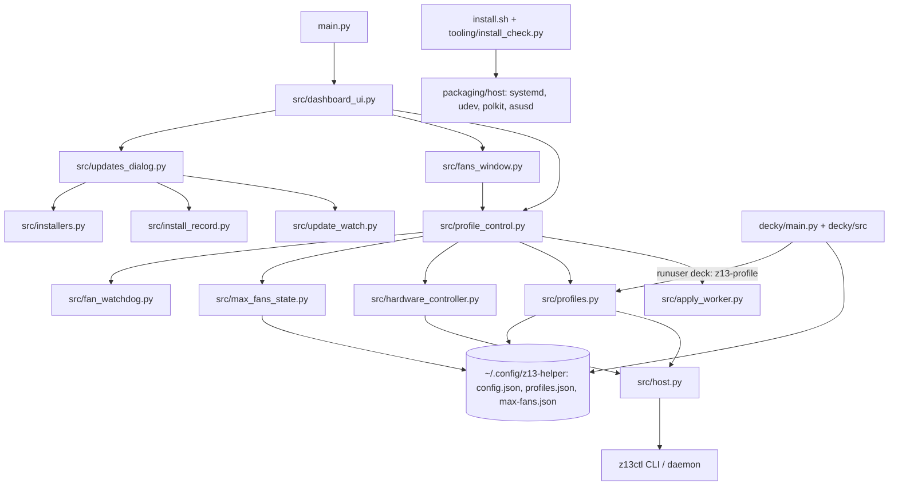

# Code map

The whole repo, one row per module: what it owns, who calls it and which Must it serves (SPEC.md). The Decky plugin's file-level detail is in [`decky.md`](decky.md). Describes commit: `6ccb861` (2026-10-28). Written 2026-10-26 from the tree at main, refreshed the same night after the merges of #49 (Decky profile switch) and #3 (Game Mode report), and checked against main again on 2026-10-28: no code has changed since, so the file rows below stand; the Decky detail in `decky.md` matches every listed file's blob.

Platforms (R04): Linux only, SteamOS on the GZ302 Z13. Nothing here is meant for Mac or Windows: hardware goes through `z13ctl` (ASUS firmware), and Game Mode is SteamOS's. CI (`.github/workflows/tests.yml`, push and pull request, Python 3.12) runs the logic tests on `ubuntu-latest`: `python3 -m pytest` and `python3 -m unittest discover -s decky/tests`. The device checks are the owner's (verification protocol, `docs/ROADMAP.md` §12).

## How it fits together

Both frontends read the same files under `~/.config/z13-helper/` and never cache them (principle 3). All hardware writes leave through `src/host.py` to `z13ctl` (principle 1).

## Desktop app (`main.py`, `src/`)

| Module | Owns | Called by | Musts |
|---|---|---|---|
| `main.py` | entry point: logging, single instance, install record | Flatpak `launch.sh` | all |
| `src/dashboard_ui.py` | main window (G-Helper Settings form): tiles, profile dropdown, lighting, battery, footer | `main.py` | M1, M3, M4 |
| `src/fans_window.py`, `src/fan_curve_widget.py` | Fans + Power window, the 8-point curve editor, PL1/PL2/PL3 sliders | `dashboard_ui` | M1, M2 |
| `src/profile_control.py` | profile store + live pushes shared by both windows | `dashboard_ui`, `fans_window` | M1, M2, M6 |
| `src/profiles.py` | named profiles, the write order (principle 4), `z13-profile` CLI, lightbar recovery | `profile_control`, `tooling/profiles/*`, Decky (as deck) | M1, M6, M8, M10 |
| `src/apply_worker.py` | one background thread that runs hardware writes in order | `profile_control` | M1, M6 |
| `src/hardware_controller.py` | brightness, battery, TDP and curve calls through `host` | `profile_control`, `dashboard_ui` | M1, M8 |
| `src/host.py` | the one way to run a host command (Flatpak-spawn aware) | `hardware_controller`, `profiles`, `update_watch`, `installers` | all |
| `src/max_fans_state.py` | Max Fans file shared with Decky (locking, atomic writes) | `profile_control`, Decky copy | M2 |
| `src/fan_watchdog.py` | keeps the asked-for curve running (fan-stall and curve-drop recovery) | `profile_control` | M2, M6 (curve-drop branch retires once the daemon re-applies), M10 (#30) |
| `src/sensor_reader.py`, `src/power_range.py` | temperatures, fan RPM, per-rail limit ranges (read only) | `dashboard_ui`, `fans_window` | M1 |
| `src/screen_brightness.py` | built-in display backlight | `dashboard_ui` | M3 |
| `src/evdev_listener.py` | Armoury Crate side button | `dashboard_ui` | M3 |
| `src/update_watch.py`, `src/updates_dialog.py` | upstream watch + Updates window | `dashboard_ui` | M4, M7 |
| `src/install_record.py`, `src/installers.py` | what `install.sh` recorded; Repair and Install/Update buttons | `updates_dialog` | M4, M7 |
| `src/app_log.py`, `src/log_dialog.py` | crash and error log, Help -> Error log | everything | all |
| `src/config_manager.py`, `src/single_instance.py`, `src/theme.py` | settings file, single-instance guard, G-Helper look | `main.py`, windows | all |

## Game Mode (`decky/`)

`decky/main.py` is the root backend (a copy of the profile, Max Fans and lightbar logic, run as deck for user-session calls). `decky/src/` is the QAM panel (profile switch, power limits, battery limit, keyboard brightness, telemetry). `decky/src/profileSwitch.ts` (merged, #16) is the pure switch flow behind the Profile dropdown: apply, then re-read the active profile and Max Fans; its tests run under plain Node (`decky/tests/profileSwitch.test.ts`). Detail: [`decky.md`](decky.md). Musts: M5, M6, M7 (the "SteamOS updated" line).

## Host side and tooling

| Path | Owns | Musts |
|---|---|---|
| `install.sh`, `tooling/install_check.py` | install, `--repair`, `verify`; keep-list registration | M4, M7 |
| `packaging/host/` | systemd units (fan resume, lightbar reset, z13ctl perms, button watcher, profile restore), udev, polkit, asusd | M1, M2, M8 |
| `tooling/profiles/` | `z13-max/balanced/cool` thin wrappers, `z13-restore-profile` | M1 |
| `tooling/boondock` | the local-LLM stack launcher (cleanup in M8) | M8 |
| `tooling/z13ctl-install/` | vendored z13ctl tarball (rollback copy) | M6 |
| `tooling/post-update/` (planned) | post-update recipes: one `check` + `apply` per task | M7 |
| `tooling/diag/`, `tooling/z13_*.py` | diagnostics and Game Mode reports; `tooling/z13_gamemode_report.py` (merged, #3) reads a Game Mode session back from local logs (tests: `tests/test_gamemode_report.py`) | M9, M10 |
| `tooling/z13-button-watcher`, `tooling/z13_qam.py`, `tooling/z13_cdp.py`, `tooling/spike1_qam_test.py` | the side-button watcher and the QAM/CDP probes used for Game Mode checks | M3, M5 |
| `tests/`, `decky/tests/` | pytest logic tests in `tests/` (30 files, CI, `ubuntu-latest`; `pytest.ini` collects only `tests/`), the Decky backend tests (`decky/tests/test_backend.py`, not collected by pytest, but CI runs them with `unittest discover -s decky/tests`) and the Node test for `profileSwitch.ts` (run by hand: `node --test decky/tests/profileSwitch.test.ts`; CI does not run it); `tests/README.md` describes the suite's guard and lists some of the pytest files (not all 30) | all |
| `flatpak/` | the Flatpak build and launcher | all |

## Open-source pieces

- [`z13ctl`](https://github.com/dahui/z13ctl): the only hardware writer. Named profiles and its event socket are M6's base.
- [Decky Loader](https://github.com/SteamDeckHomebrew/decky-loader): Game Mode host for the plugin.
- [G-Helper](https://github.com/seerge/g-helper): the layout and behaviour reference (Phase 9).
- steamos-manager remotes: the route for Steam's own controls, which is #29 and comes after 1.0.
