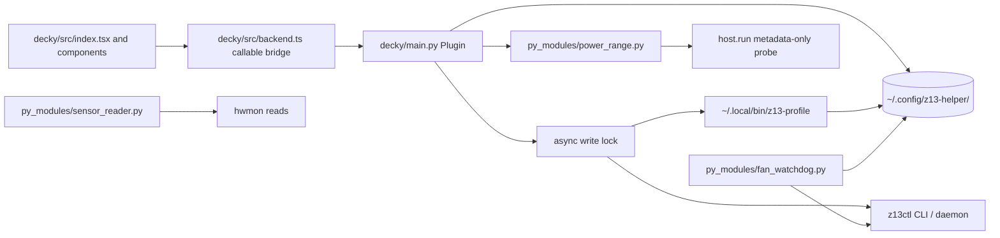

# Decky / Game Mode code map

This describes the Decky source in the current checkout (`8c857cd`, 2026-10-30). It is not a claim that the open review stack has merged or that all Game Mode behavior has been verified on the device. The current code map is [`README.md`](README.md); the pending verification checklist is in [`docs/ROADMAP.md`](../docs/ROADMAP.md).

## Runtime and data flow

The backend runs as the `deck` user under Decky Loader. `decky/main.py` imports shared helpers from its `py_modules/` directory; `install.sh` and `tooling/install_check.py` source those files from `src/` and install the copies root-owned. Root ownership protects the code files; it does not mean the backend runs as root. `src/host.py` chooses an execution mode from the process environment. When Decky is already running as `deck`, `as_deck=True` supplies Deck's runtime and session-bus environment without `runuser`; `runuser -u deck` is used only if a root-mode process requests it. Calls to z13ctl go through `host.run()` and use the existing user daemon/socket.

The desktop app, the installed `z13-profile` CLI and Decky share `~/.config/z13-helper/profiles.json` and `max-fans.json`. The `profiles.py` engine owns the profile schema and profile apply ordering. Decky's app-profile dropdown invokes that engine's CLI rather than duplicating profile application logic. Other Decky controls use the backend methods described below. The z13ctl daemon keeps separate custom-profile state under `~/.local/state/z13ctl/`; the shared app files and that daemon state are separate sources of truth, and profile changes explicitly restore or reset z13ctl's stored thermal overrides where needed.

Decky re-reads shared state when its methods need it rather than holding a long-lived profile/snapshot cache. Its async write lock serializes profile, TDP, brightness, battery and Max Fans requests. Blocking commands and file work are run with `asyncio.to_thread`. A watchdog tick is skipped while that lock is held. In Game Mode, the Decky watchdog owns fan enforcement; while Desktop Mode is active it stands down so the resident PyQt app can enforce the same rules.

## Files and responsibilities

| Path | Responsibility |
|---|---|
| `decky/main.py` | Decky backend and callable API. Profile reads/switches, Max Fans, direct performance profile, power, battery limit, brightness, telemetry, desktop-app check and Game Mode watchdog lifecycle. |
| `decky/src/index.tsx` | QAM panel composition and profile switch flow. |
| `decky/src/backend.ts` | Typed Decky callable names, results and shared TDP clamping rule. |
| `decky/src/profileSwitch.ts` | Pure async flow for profile changes: apply, then re-read profile and Max Fans whether apply succeeds or fails. |
| `decky/src/hooks.ts` | Slider commit-on-release and visibility polling hooks. |
| `decky/src/components/PowerLimits.tsx` | Profile-scoped TDP override controls; no override is labeled “Not set” and remains distinct from the displayed fallback slider positions. |
| `decky/src/components/BatteryLimit.tsx` | Battery charge limit control. |
| `decky/src/components/KeyboardBrightness.tsx` | Keyboard brightness control. |
| `decky/src/components/Telemetry.tsx` | APU/GPU temperatures and fan RPM display. |
| Installed plugin `py_modules/fan_watchdog.py` | Root-owned installed copy of `src/fan_watchdog.py`; dropped-curve and fan-stall recovery logic. |
| Installed plugin `py_modules/sensor_reader.py` | Root-owned installed copy of `src/sensor_reader.py`; read-only hwmon collection. |
| Installed plugin `py_modules/power_range.py` | Root-owned installed copy of `src/power_range.py`; per-rail metadata bounds matching z13ctl backend selection. |
| Installed plugin `py_modules/host.py` | Root-owned installed copy of `src/host.py`; host command mode and environment handling. |
| `decky/tests/test_backend.py` | Backend tests, run with `python3 -m unittest discover -s decky/tests`. |
| `decky/tests/profileSwitch.test.ts` | Node tests for the pure profile switch helper; run manually with `node --test decky/tests/profileSwitch.test.ts` (not part of CI). |

## Profile, Max Fans and watchdog paths

`get_profiles()` runs `z13-profile list --json` and returns the names plus active app profile. `set_app_profile(name)` runs `z13-profile apply <name>` under the serialized write lock and off the event loop. The frontend then re-reads the active firmware profile and Max Fans state so a partial failure does not leave the dropdown showing an unconfirmed request.

`max-fans.json` contains the shared `enabled` intent and an optional eight-point raw-PWM snapshot. ON snapshots the current curve when available and writes the all-100% curve; OFF restores the saved snapshot, otherwise the active profile curve if the snapshot is unknown, or firmware auto when the snapshot explicitly contains `null`. The lock and atomic write helpers keep desktop and Decky edits from losing each other's state. A Max Fans profile also influences the profile engine's planned final state.

The Game Mode watchdog uses the same `src/fan_watchdog.py` implementation as the desktop app. A dropped-curve recovery rechecks Max Fans intent and whether the custom curve is still dropped when its worker action starts; if the queued profile operation has already changed either condition, the obsolete recovery is skipped. An in-flight recovery checks Max Fans again after profile/TDP restoration and before writing the 100% curve. In Game Mode, the plugin's write lock also prevents watchdog recovery from interleaving with a Decky profile apply. The recovery rule is separate from the desktop profile engine's temporary OFF flag, which prevents the desktop worker from re-pinning the previous 100% curve during a profile transition.

## Power-range behavior and persisted values

`power_range.detect_ranges()` matches z13ctl 1.4.2's choice: Armoury is selected when the host sees PL1's writable `current_value` node and sane min/max metadata. For each present rail it reads only `min_value` and `max_value`, including the Armoury PL3 attribute `ppt_pl3_fppt`; it does not read live `current_value`. A Decky process calls the helper directly on the host. In Flatpak, the same metadata-only check is sent via `host.run()` to host Python, since sandbox permission checks on sysfs can be false negatives. If Armoury is unavailable, Decky uses the legacy 5–93 W UI bounds; malformed/missing per-rail metadata also receives that fallback because the response schema requires all three rails.

`power_state()` reads the active profile override from `profiles.json`, clamps only the values presented to the current per-rail ranges, and includes an explanatory note when stored values exceed a range. It does not rewrite the profile on read. When the profile has no override, `tdp_enabled` is false; the UI labels each rail “Not set”, hides its fallback numeric value, and says firmware controls it. No live Armoury PPT value is polled. `set_tdp()` first validates that the request still targets the active profile, updates that profile's stored override, then calls z13ctl to apply or hands limits back to the firmware.

## Tests and verification boundary

CI runs the pytest suite and Decky backend unittest suite. The Node profile-switch test is separate and is run manually. These tests verify API shape, command construction, shared store behavior, locking and pure transition logic; they do not verify the live Decky QAM or actual firmware response. On-device Game Mode, suspend/resume, and cold-boot behavior remain owner-device checks recorded in the roadmap.
