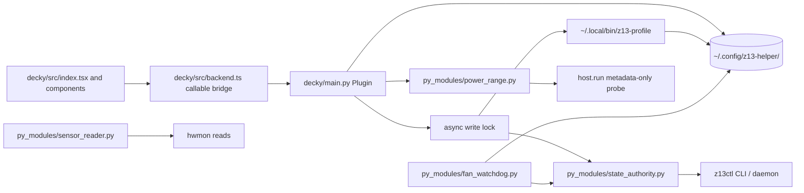

# Decky / Game Mode code map

Refreshed 2026-11-07 from `main` at `84f0b1e`. The shared state owner (#23) and post-update repair (#27) are implemented in the current tree. This describes the Decky source and wiring; it is not a claim that all Game Mode behavior has been verified on the device. The main code map is [`README.md`](README.md); remaining device checks are in [`docs/ROADMAP.md`](../docs/ROADMAP.md).

## Runtime and data flow

The backend runs as the `deck` user under Decky Loader. `decky/main.py` imports shared helpers from its `py_modules/` directory; `install.sh` and `tooling/install_check.py` source those files from `src/` and install the copies root-owned. Root ownership protects the code files; it does not mean the backend runs as root. `src/host.py` chooses an execution mode from the process environment. When Decky is already running as `deck`, `as_deck=True` supplies Deck's runtime and session-bus environment without `runuser`; `runuser -u deck` is used only if a root-mode process requests it. Calls to z13ctl go through `host.run()` and use the existing user daemon/socket.

The desktop app, installed `z13-profile` CLI and Decky share the same state authority.
Production field edits, Max Fans and platform-profile changes call `state_authority` from installed
copies; full profile selection invokes the host engine, which uses that same authority. Decky no
longer owns separate production profile/Max Fans store writers or direct field-write paths.
All thermal writes carry named targets after a JSON API probe. The authority holds
a process-shared lock across complete applies and fan recoveries, in addition to
Decky's async request lock. Queued edits validate their original profile before
saving or applying.

A cancellable host watch stream reconciles daemon state and sends `profile_state`
through `decky.emit`. The mounted React panel listens, cancels pending sliders,
and refreshes profiles, Max Fans, TDP, battery and brightness. It removes the
listener on unmount; backend unload stops/reaps the watch process. Subscription
loss reconnects with a fresh snapshot, without profile polling. Telemetry and fan
safety sampling remain independent. The older backend helper functions remain
compatibility test coverage; production setters use the shared authority.

## Files and responsibilities

| Path | Responsibility |
|---|---|
| `decky/main.py` | Decky backend and callable API. Profile reads/switches, Max Fans (records goal transitions to `timeline.jsonl`), direct performance profile via the shared authority, power, battery limit, brightness (manual TDP, charge-limit and brightness writes each record a `timeline.jsonl` setting entry via `timeline.record_setting_change`, best-effort), telemetry, `get_timeline`, post-update status/repair, desktop-app check and Game Mode watchdog lifecycle. `BackendMemoryGuard` monitors current process RSS on a separate thread every 5 s, exits only this backend at 500 MiB, and stops/joins on unload (sampled threshold; process isolation, respawn and plugin reload after a trip are unverified, needs device check). Each z13ctl write uses `host.Z13CTL_WRITE_TIMEOUT_S` (20 s); a profile apply gets its own 180 s budget (`PROFILE_APPLY_TIMEOUT_S`). Write callables return `{ok, message}`, so a timeout reaches the panel as text. TDP, battery limit, brightness and profile writes route through `state_authority`; the watchdog uses the authority adapter. Key: `Plugin` (callable methods, `_main`/`_unload`), `set_app_profile`, `set_profile`, `set_tdp`, `set_battery_limit`, `set_max_fans`, `set_brightness`, post-update callables, `power_state`, `telemetry`, `DeckyFans`, `DesktopAppCheck`, `fan_watchdog_tick`. Called by Decky Loader. |
| `decky/src/index.tsx` | QAM panel composition, profile switch flow and `profile_state` event refresh with listener cleanup. Plugin entry (`definePlugin`); uses `backend.ts`, `profileSwitch.ts`, `hooks.ts` and the four components. |
| Installed plugin `py_modules/state_authority.py`, `z13ctl_client.py`, `z13ctl_profiles.py`, `state_stream.py`, `state_events.py` | Root-owned shared authority, socket protocol, pure mapping/dispatch and host event stream. |
| Installed plugin `py_modules/profiles.py`, `hardware_controller.py`, `max_fans_state.py`, `epp.py` | Root-owned dependencies of shared field edits, Max Fans and fan recovery. |
| `decky/src/backend.ts` | Typed Decky callable names, results and shared TDP clamping rule. Key: the `callable` bridges (`getProfiles`, `setAppProfile`, `setTdp`, `setBatteryLimit`, `setBrightness`, `getTelemetry`), `clampTdp`, `safely`, `isWriteTimeout`. Called by `index.tsx` and the components. |
| `decky/src/profileSwitch.ts` | Pure async flow for profile changes: apply, then re-read profile and Max Fans whether apply succeeds or fails. Key: `switchProfile`. Called by `index.tsx`; tested by `decky/tests/profileSwitch.test.ts`. |
| `decky/src/hooks.ts` | Slider commit-on-release and visibility polling hooks. Key: `useCommitOnRelease`, `usePollWhileVisible`, `cancelPendingCommits`. Called by the components. |
| `decky/src/components/PowerLimits.tsx` | Profile-scoped TDP override controls; no override is labeled “Not set” and remains distinct from the displayed fallback slider positions. |
| `decky/src/components/BatteryLimit.tsx` | Battery charge limit control. |
| `decky/src/components/KeyboardBrightness.tsx` | Keyboard brightness control. |
| `decky/src/components/Telemetry.tsx` | CPU and GPU temperatures with their source labels, plus fan RPM display. An unreadable value shows as unavailable, and one missing fan does not hide the other. |
| Installed plugin `py_modules/fan_watchdog.py` | Root-owned installed copy of `src/fan_watchdog.py`; dropped-curve and fan-stall recovery logic; `FanTrace` history is bounded to 120 s and 256 entries. |
| Installed plugin `py_modules/sensor_reader.py` | Root-owned installed copy of `src/sensor_reader.py`; read-only hwmon collection. |
| Installed plugin `py_modules/power_range.py` | Root-owned installed copy of `src/power_range.py`; per-rail metadata bounds matching z13ctl backend selection. |
| Installed plugin `py_modules/host.py` | Root-owned installed copy of `src/host.py`; host command mode and environment handling. |
| Installed plugin `py_modules/timeline.py` | Root-owned installed copy of `src/timeline.py`; append-only `timeline.jsonl` reader/writer with size-capped rotation and partial-line skipping. |
| Installed plugin `py_modules/crash_report.py`, `crash_scrub.py`, `crash_queue.py`, `_crash_build.json` | Root-owned shared crash reporting and build configuration. Startup installs Python/thread/asyncio hooks; unload restores them. Reports share the desktop queue and preference; see [`docs/crash-reporting.md`](../docs/crash-reporting.md). |
| `decky/rollup.config.js`, `decky/tsconfig.json`, `decky/package.json`, `decky/pnpm-lock.yaml` | Bundle build for the plugin front end (`pnpm build` writes `dist/index.js`, which `install.sh` installs). |
| `decky/plugin.json` | Decky plugin manifest: name `Z13-Helper`, `api_version` 1, store metadata. Installed beside `main.py`. |
| `decky/README.md` | Plugin-specific notes: what the panel offers, how it is built and installed. |
| `decky/tests/test_backend.py` | Backend tests, run with `python3 -m unittest discover -s decky/tests`. |
| `decky/tests/test_crash_entry.py` | Plugin lifecycle test: `_main` and `_unload` install and remove the shared crash-reporting preference, loop and task hooks without real I/O. Part of the unittest suite. |
| `decky/tests/profileSwitch.test.ts` | Node tests for the pure profile switch helper; run manually with `node --test decky/tests/profileSwitch.test.ts` (not part of CI). |

## Profile, Max Fans and watchdog paths

`get_profiles()` runs `z13-profile list --json` and returns the names plus active app profile. `set_app_profile(name)` runs `z13-profile apply <name>` under the serialized write lock and off the event loop. The frontend then re-reads the active firmware profile and Max Fans state so a partial failure does not leave the dropdown showing an unconfirmed request.

`max-fans.json` contains the shared `enabled` intent and an optional eight-point raw-PWM snapshot. ON snapshots the current curve when available and writes the all-100% curve; OFF restores the saved snapshot, otherwise the active profile curve if the snapshot is unknown, or firmware auto when the snapshot explicitly contains `null`. The lock and atomic write helpers keep desktop and Decky edits from losing each other's state. A Max Fans profile also influences the profile engine's planned final state.

The Game Mode watchdog uses the same `src/fan_watchdog.py` implementation as the desktop app. A dropped-curve recovery rechecks Max Fans intent and whether the custom curve is still dropped when its worker action starts; if the queued profile operation has already changed either condition, the obsolete recovery is skipped. An in-flight recovery checks Max Fans again after profile/TDP restoration and before writing the 100% curve. In Game Mode, the plugin's write lock also prevents watchdog recovery from interleaving with a Decky profile apply. The recovery rule is separate from the desktop profile engine's temporary OFF flag, which prevents the desktop worker from re-pinning the previous 100% curve during a profile transition.

## Power-range behavior and persisted values

`power_range.detect_ranges()` matches z13ctl 1.4.2's choice: Armoury is selected when the host sees PL1's writable `current_value` node and sane min/max metadata. For each present rail it reads only `min_value` and `max_value`, including the Armoury PL3 attribute `ppt_pl3_fppt`; it does not read live `current_value`. A Decky process calls the helper directly on the host. In Flatpak, the same metadata-only check is sent via `host.run()` to host Python, since sandbox permission checks on sysfs can be false negatives. If Armoury is unavailable, Decky uses the legacy 5–93 W UI bounds; malformed/missing per-rail metadata also receives that fallback because the response schema requires all three rails.

`power_state()` reads the active profile override from `profiles.json`, clamps only the values presented to the current per-rail ranges, and includes an explanatory note when stored values exceed a range. It does not rewrite the profile on read. When the profile has no override, `tdp_enabled` is false; the UI labels each rail “Not set”, hides its fallback numeric value, and says firmware controls it. No live Armoury PPT value is polled. `set_tdp()` first validates that the request still targets the active profile, updates that profile's stored override, then calls z13ctl to apply or hands limits back to the firmware.

## Tests and verification boundary

CI runs the pytest suite and Decky backend unittest suite. The Node profile-switch test is separate and is run manually. These tests verify API shape, command construction, shared store behavior, locking and pure transition logic; they do not verify the live Decky QAM or actual firmware response. On-device Game Mode, suspend/resume, and cold-boot behavior remain owner-device checks recorded in the roadmap.

Memory investigation: [`docs/fan-watchdog-memory.md`](../docs/fan-watchdog-memory.md) records the source audit and containment limitations. `tests/test_backend_memory.py` covers the monitor and plugin lifecycle; `tests/test_fan_trace.py` covers trace bounds. #30 remains open until a completed 24-hour sampler run is interpreted.

Named fan recovery uses the authority to restore the same target after its base
rewrite, without profile hooks. Legacy recovery retains its existing checks and
also holds the hardware transaction lock. #66's curve-drop retirement still
requires separate device evidence.
